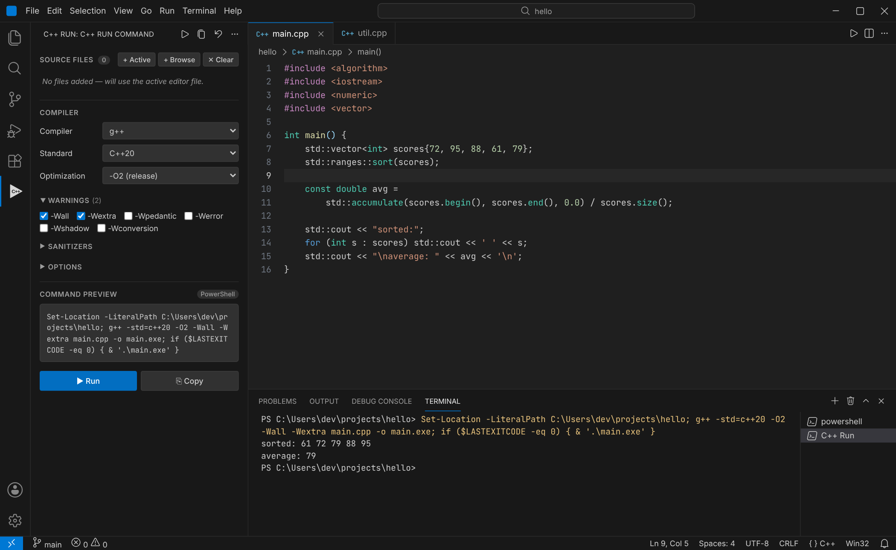
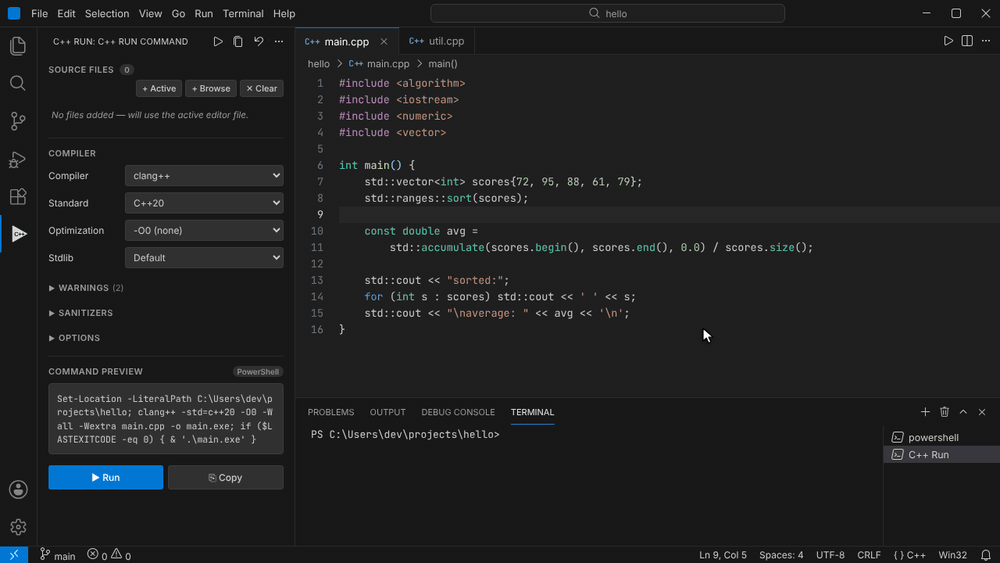
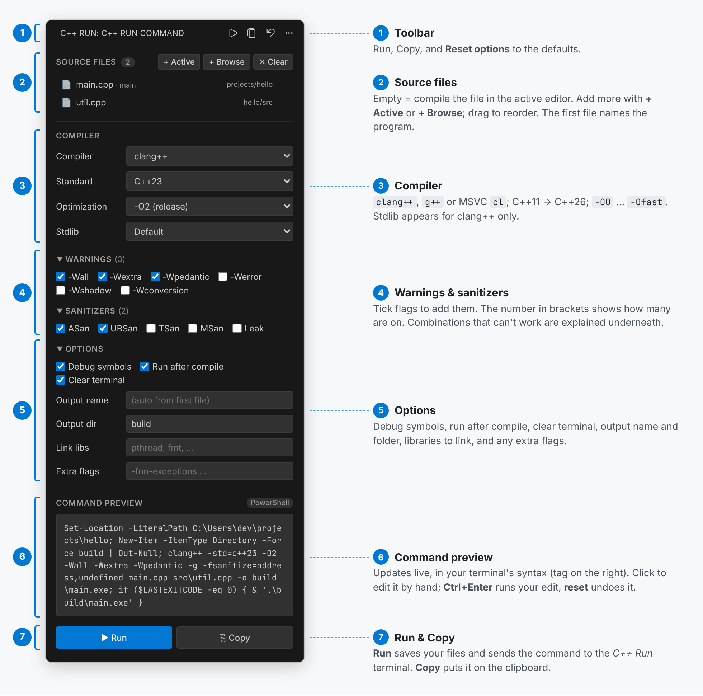
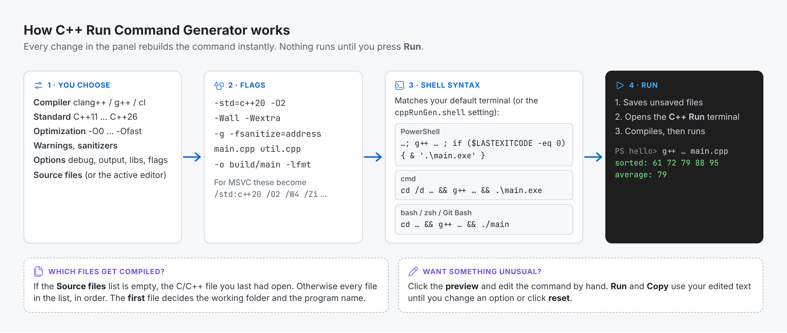
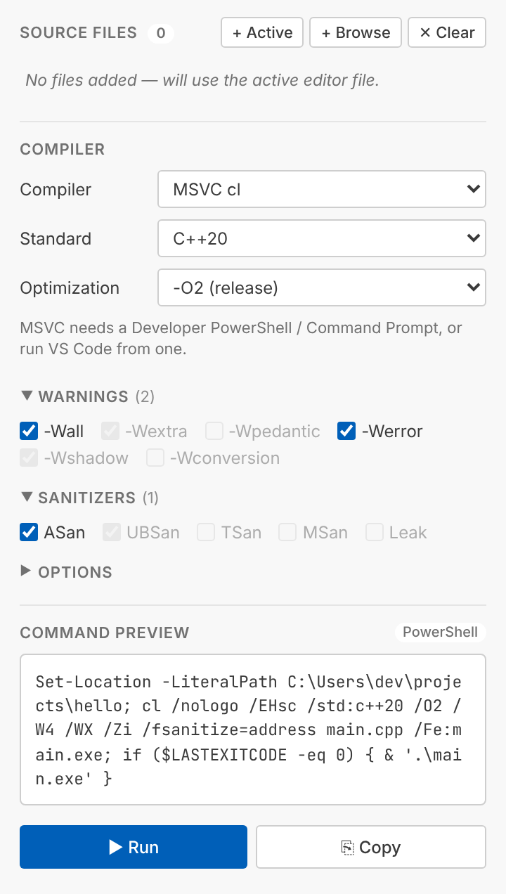

# C++ Run Command Generator

[](https://marketplace.visualstudio.com/items?itemName=lawrenceshin.cpp-run-command-gen)
[](https://marketplace.visualstudio.com/items?itemName=lawrenceshin.cpp-run-command-gen)
[](LICENSE)

Compile and run C++ files from a **sidebar panel** instead of typing compiler commands.
Pick the compiler, C++ standard, optimization level, warnings and sanitizers; the panel shows the exact command as you go, and **▶ Run** compiles and runs it in the terminal.

No `tasks.json`, no CMake, no configuration files. Good for single files, practice problems, coursework and small multi-file programs.



## Contents

- [Features](#features)
- [Installation](#installation)
- [Before you start: install a compiler](#before-you-start-install-a-compiler)
- [Quick start](#quick-start)
- [The panel, step by step](#the-panel-step-by-step)
- [Compiling several files](#compiling-several-files)
- [Editing the command by hand](#editing-the-command-by-hand)
- [How it works](#how-it-works)
- [Windows terminals: PowerShell, cmd and Git Bash](#windows-terminals-powershell-cmd-and-git-bash)
- [Using MSVC (cl)](#using-msvc-cl)
- [Keyboard shortcuts and commands](#keyboard-shortcuts-and-commands)
- [Settings](#settings)
- [Troubleshooting](#troubleshooting)
- [FAQ](#faq)

## Features

- **Sidebar panel** in the Activity Bar, with every option visible in one place.
- **Live command preview** that updates as you click, in the syntax of *your* terminal (PowerShell, cmd, bash/zsh, Git Bash).
- **One-click Run**: saves your files, compiles, and runs the program in a dedicated *C++ Run* terminal.
- **Three compilers**: `clang++`, `g++` and MSVC `cl` (flags are translated for MSVC automatically).
- **C++11 to C++26**, `-O0` to `-Ofast`, six common warning flags, five sanitizers, debug symbols, `libc++` / `libstdc++`.
- **Multi-file builds** with drag-to-reorder, custom output name and folder, libraries to link, extra flags.
- **Editable preview** for one-off tweaks, and **Copy** to paste the command anywhere.
- **Remembers your choices** between sessions.

## Installation

**From the Marketplace (recommended):** open the Extensions view (`Ctrl+Shift+X`), search for **C++ Run Command Generator**, and click **Install**.

**From the command line:**

```bash
code --install-extension lawrenceshin.cpp-run-command-gen
```

**From a `.vsix` file** (download one from the [Releases page](https://github.com/LEF9701/cpp-run-command-gen/releases)):

```bash
code --install-extension cpp-run-command-gen-2.1.0.vsix
```

or in VS Code: Extensions view → `…` menu → **Install from VSIX…**

## Before you start: install a compiler

The extension *runs* your compiler; it doesn't include one. You need at least one of these on your `PATH`:

| System | Easiest option | Check it works |
|---|---|---|
| **Windows** | [MSYS2](https://www.msys2.org/) → `pacman -S mingw-w64-ucrt-x86_64-gcc`, then add `C:\msys64\ucrt64\bin` to `PATH` | `g++ --version` |
| | or [LLVM](https://github.com/llvm/llvm-project/releases) for `clang++` | `clang++ --version` |
| | or Visual Studio / Build Tools with *Desktop development with C++* for `cl` ([see MSVC](#using-msvc-cl)) | `cl` |
| **macOS** | `xcode-select --install` (gives you `clang++`; `g++` is an alias for it) | `clang++ --version` |
| **Linux** | `sudo apt install build-essential clang` (Debian/Ubuntu) | `g++ --version` |

Run the check in VS Code's terminal (`` Ctrl+` ``). If it prints a version, you're ready. After changing `PATH`, restart VS Code.

## Quick start



1. **Open the panel.** Click the **C++ ▶** icon in the Activity Bar on the left.
2. **Open a `.cpp` file.** The command preview fills in for that file.
3. **Pick your options**: compiler, standard, optimization, any warnings.
4. **Press ▶ Run** (or `Ctrl+Alt+R` in the editor). The *C++ Run* terminal opens, the program is compiled, and if compiling succeeds it runs.

If your program reads input (`std::cin`), click into the terminal and type there.

## The panel, step by step



### 1 · Toolbar

At the top of the panel: **▶ Run**, **Copy**, and **↺ Reset options** (back to the defaults below).

### 2 · Source files

- **Empty list** (the default): the extension compiles the C/C++ file you were last editing. This is all you need for single-file programs.
- **+ Active** adds the file in the current editor. **+ Browse** opens a file picker (you can select several).
- **Drag** a file to reorder; **✕** next to a file removes it; **✕ Clear** removes all.
- The **first** file (marked *· main*) decides the working folder and the program's name.

### 3 · Compiler

| Option | Choices | Default |
|---|---|---|
| **Compiler** | `clang++`, `g++`, MSVC `cl` | `clang++` |
| **Standard** | C++11, 14, 17, 20, 23, 2c (26) | C++20 |
| **Optimization** | `-O0` none · `-O1` · `-O2` release · `-O3` aggressive · `-Os` size · `-Ofast` | `-O0` |
| **Stdlib** *(clang++ only)* | Default, `libc++`, `libstdc++` | Default |

Use `-O0` while debugging (fast to compile, easy to step through) and `-O2` when you care about speed.

### 4 · Warnings and sanitizers

Click a heading to expand it. The number in brackets shows how many are ticked.

| Warning | What it catches |
|---|---|
| `-Wall` | The common mistakes: unused variables, missing `return`, suspicious comparisons… *(on by default)* |
| `-Wextra` | More checks, e.g. unused parameters, signed/unsigned comparisons *(on by default)* |
| `-Wpedantic` | Code that isn't strict standard C++ (compiler extensions) |
| `-Werror` | Turns every warning into an error, so the build stops |
| `-Wshadow` | A variable that hides another with the same name |
| `-Wconversion` | Implicit conversions that can lose data (`double` → `int`, etc.) |

Sanitizers add run-time checks; the program runs slower but stops with a clear report when something goes wrong.

| Sanitizer | Flag | Finds |
|---|---|---|
| **ASan** | `address` | Out-of-bounds access, use-after-free, double free |
| **UBSan** | `undefined` | Signed overflow, null dereference, bad shifts and other undefined behaviour |
| **TSan** | `thread` | Data races between threads *(can't be combined with ASan/Leak)* |
| **MSan** | `memory` | Reading uninitialised memory *(clang++ on Linux only, must be used alone)* |
| **Leak** | `leak` | Memory you allocated and never freed |

Sanitizers are best supported on **Linux and macOS**. On Windows, MinGW `g++` doesn't support them; use MSVC with ASan, or clang++. The panel tells you when a combination can't work.

Tip: ASan + UBSan + Debug symbols is a great combination while learning; it turns silent crashes into readable error messages with line numbers.

### 5 · Options

| Option | Effect | Default |
|---|---|---|
| **Debug symbols** | Adds `-g` (`/Zi` for MSVC) so a debugger can show your source lines | off |
| **Run after compile** | Runs the program when compiling succeeds. Untick to only compile. | on |
| **Clear terminal** | Clears the *C++ Run* terminal before each run | on |
| **Output name** | Program name. Empty = name of the first file (`main.cpp` → `main` / `main.exe`) | empty |
| **Output dir** | Folder for the program, relative to the first file or absolute. Created if missing. Empty = next to the source | empty |
| **Link libs** | Libraries to link, separated by spaces or commas. `pthread, fmt` → `-lpthread -lfmt` (MSVC: `pthread.lib fmt.lib`) | empty |
| **Extra flags** | Anything else, passed as-is, e.g. `-DDEBUG -I include -fno-exceptions` | empty |

### 6 · Command preview

The exact command that **Run** will send. The tag in the corner shows which shell syntax it uses. You can click into it and edit it; see [Editing the command by hand](#editing-the-command-by-hand).

### 7 · Run and Copy

- **▶ Run** saves any unsaved source files, opens (or reuses) the **C++ Run** terminal, and sends the command.
- **⎘ Copy** puts the command on the clipboard, to paste into a script, a README, or another terminal.

## Compiling several files

When your program is split into files, add them all to **Source files**:

1. Open `main.cpp` and click **+ Active**.
2. Click **+ Browse** and select the other `.cpp` files (not the headers; headers are found through `#include`).
3. Keep the file with `main()` first, so the program gets a sensible name.

With *Output dir* = `build` and *Output name* = `app`, the preview looks like this (Linux):

```bash
cd /home/you/game && mkdir -p build && clang++ -std=c++20 -O0 -Wall -Wextra main.cpp src/board.cpp src/ai.cpp -o build/app && ./build/app
```

If your headers live in another folder, add `-I include` (or that folder) to **Extra flags**.

The list is remembered per workspace. Click **✕ Clear** to go back to compiling just the active file.

## Editing the command by hand

Sometimes you need something the panel doesn't offer, such as passing arguments to your program, or redirecting input from a file:

1. Click into the **Command preview** and edit it, e.g. add `< input.txt` at the end.
2. An **edited** badge appears. **Run** and **Copy** now use your text.
3. **Ctrl+Enter** inside the preview runs it straight away.
4. Click **reset**, or change any option, to go back to the generated command.

## How it works



The extension never compiles anything in the background. It builds a command line from your choices, shows it, and on **Run** types it into a normal VS Code terminal, exactly as if you had typed it yourself. That means the command always works the same way when you copy it elsewhere.

## Windows terminals: PowerShell, cmd and Git Bash

Each shell needs different syntax to "go to the folder, compile, then run only if compiling worked". The extension detects your **default terminal profile** and writes the right one. The same settings (`g++`, `-O2`) produce:

**PowerShell** (the Windows default):

```powershell
Set-Location -LiteralPath C:\Users\you\hello; g++ -std=c++20 -O2 -Wall -Wextra main.cpp -o main.exe; if ($LASTEXITCODE -eq 0) { & '.\main.exe' }
```

**Command Prompt (cmd):**

```bat
cd /d C:\Users\you\hello && g++ -std=c++20 -O2 -Wall -Wextra main.cpp -o main.exe && .\main.exe
```

**Git Bash / MSYS2:**

```bash
cd C:/Users/you/hello && g++ -std=c++20 -O2 -Wall -Wextra main.cpp -o main.exe && ./main.exe
```

**macOS / Linux (bash, zsh):**

```bash
cd /Users/you/hello && g++ -std=c++20 -O2 -Wall -Wextra main.cpp -o main && ./main
```

If you change your default terminal (*Terminal: Select Default Profile*), close the *C++ Run* terminal so the next run opens a new one. To force a syntax, use the [`cppRunGen.shell`](#settings) setting.

## Using MSVC (cl)



`cl` only works in a terminal where Visual Studio's environment is loaded. Either:

- start VS Code **from** a *Developer PowerShell for VS* / *Developer Command Prompt for VS* (type `code .` there), or
- set your default terminal profile to the Developer PowerShell.

The panel translates your choices to MSVC flags:

| Panel | g++ / clang++ | MSVC `cl` |
|---|---|---|
| Standard C++11 / 14 | `-std=c++11` / `-std=c++14` | `/std:c++14` (MSVC's oldest) |
| Standard C++17 / 20 | `-std=c++17` / `-std=c++20` | `/std:c++17` / `/std:c++20` |
| Standard C++23 / 26 | `-std=c++23` / `-std=c++2c` | `/std:c++latest` |
| `-O0` / `-O1` / `-O2` / `-O3`, `-Ofast` / `-Os` | same | `/Od` / `/O1` / `/O2` / `/Ox` / `/Os` |
| `-Wall` / `-Werror` | same | `/W4` / `/WX` |
| Debug symbols | `-g` | `/Zi` |
| ASan | `-fsanitize=address` | `/fsanitize=address` |
| Link `fmt` | `-lfmt` | `fmt.lib` |
| Output | `-o main.exe` | `/Fe:main.exe` |
| always added | | `/nologo /EHsc` |

Options MSVC has no equivalent for (`-Wextra`, `-Wshadow`, UBSan, …) are greyed out. They stay ticked, so they come back if you switch to another compiler.

## Keyboard shortcuts and commands

| Command (Command Palette → "C++ Run") | Windows / Linux | macOS |
|---|---|---|
| **C++ Run: Compile & Run** | `Ctrl+Alt+R` | `Cmd+Alt+R` |
| **C++ Run: Copy Command** | `Ctrl+Alt+C` | `Cmd+Alt+C` |
| **C++ Run: Reset Options to Defaults** | | |

The shortcuts work while a C or C++ file has focus. There's also a **▶** button in the editor title bar for C/C++ files.

To change a shortcut: **File → Preferences → Keyboard Shortcuts**, search for `C++ Run`, and double-click the shortcut.

## Settings

| Setting | Values | Default |
|---|---|---|
| `cppRunGen.shell` | `auto`, `powershell`, `cmd`, `bash` | `auto`, which follows your default VS Code terminal |

Everything else is set in the panel and remembered automatically: options for all projects, the source-file list per workspace.

## Troubleshooting

**"`g++` is not recognized" / "command not found"**
The compiler isn't on your `PATH`. Check with `g++ --version` in a new VS Code terminal; see [install a compiler](#before-you-start-install-a-compiler). Restart VS Code after editing `PATH`.

**"`cl` is not recognized"**
VS Code wasn't started from a Developer Prompt. See [Using MSVC](#using-msvc-cl).

**The preview says "(add source files or open a C++ file)"**
Open a `.cpp`, `.cc`, `.cxx` or `.c` file, or add files to the list.

**The command fails in my terminal with a syntax error**
The preview tag shows which shell syntax is used. If it doesn't match your terminal, set `cppRunGen.shell`, and close the old *C++ Run* terminal.

**"Permission denied" / "cannot open output file main.exe"**
The previous run of your program is still running (maybe waiting for input). Press `Ctrl+C` in the *C++ Run* terminal, then run again.

**Sanitizer link errors such as `cannot find -lasan` or `libclang_rt.asan…`**
Your compiler installation doesn't include sanitizer runtimes (common with MinGW on Windows). Untick the sanitizers, or use a toolchain that has them.

**The program seems to hang**
It's probably waiting for input (`std::cin`): click into the terminal and type it, then press Enter.

**The shortcut doesn't do anything**
Click into the editor first (shortcuts only work when a C/C++ file has focus), or check for a conflict in *Keyboard Shortcuts*.

## FAQ

**Does this replace CMake or `tasks.json`?**
No. It's for quickly compiling and running code without a build system. For larger projects, use CMake; you can still use **Copy** to grab a command to start from.

**Can I debug with it?**
Tick **Debug symbols**, compile, then start a debugger (e.g. the C/C++ extension's *Debug C/C++ File*, or `gdb ./main`) on the program it built.

**Does it work for C?**
`.c` files can be added, but they are compiled with the C++ compiler you chose, as C++.

**Where are my options stored?**
In VS Code's extension storage, not in your project, so nothing is added to your repository.

## Contributing

Bug reports and ideas are welcome in [Issues](https://github.com/LEF9701/cpp-run-command-gen/issues).

```bash
git clone https://github.com/LEF9701/cpp-run-command-gen.git
cd cpp-run-command-gen
npm test            # unit tests for the command builder (Node 20+)
npx @vscode/vsce package
```

Press `F5` in VS Code to try your changes in an Extension Development Host.

| File | Purpose |
|---|---|
| `src/command.js` | Builds the command line (pure function, unit-tested) |
| `src/extension.js` | Panel, commands, terminal, saved state |
| `media/panel.html`, `panel.css`, `panel.js` | The sidebar panel |

See [CHANGELOG.md](CHANGELOG.md) for release notes.

## License

[MIT](LICENSE) © 2026 Lawrence Shin
